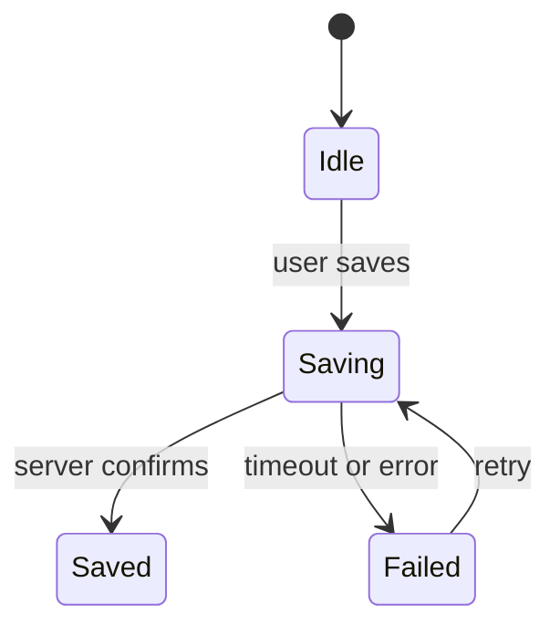

<!-- Modified by Flow Copilot from mattpocock/skills revision 4ae2317ddb22b046e26455e4f9c9b3aaaf62212d. -->

Use this template for writing the PR body:

```markdown
## Why

<One or two sentences: the problem or the goal. Link the issue.>

## What changes

<One diagram with a Before and an After:
- a state diagram when the system waits for something outside it (a user
  action, a reply from a service or device, a webhook, a timer, a cancel);
  draw the bad events too: timeout, error, cancel, retry
- a call tree for control flow inside the code
- a flowchart for data flow and how components interact
- a table or a diff when no diagram fits>

<Up to three bullets for what the diagram misses.>

## Before and after

<UI changes only: before-and-after screenshots side by side. A short
recording for user flows and animations, so the reviewer sees the flow end
to end.>

## Risk

<Only when a revert can't undo the change, or the change touches auth, data,
secrets, or production. One or two plain sentences: what breaks, and for whom.>

## After merge

<Manual steps in order. Delete if none.>
```

## Sections

Skip all preambles and keep prose brief. Use the user's domain language from `GLOSSARY.md`. Delete a section when it has no job in this PR.

### Why

One or two sentences: the problem or the goal. Link the issue when there is one.

### What changes

Show one Before and one After. Pick the smallest view that makes the key point clear. First ask: does the next step wait for something outside the system, which can come late, come wrong, or not come? Outside inputs are a user action, a reply from a service or a device, a webhook, a timer, or a cancel.

- If yes, show it as a Mermaid state diagram. A state is a place where the system waits. An arrow is the event that moves it on. Draw the bad events too: timeout, error, cancel, retry.



If no, pick a view from [references/visuals.md](references/visuals.md): pseudocode, a call tree, a component tree, a file tree, a Mermaid flowchart or sequence diagram, or a diff.

### Before and after

For UI changes only. Put before-and-after screenshots side by side, cropped to the changed area. For user flows and animations, add a short recording, so the reviewer sees the flow end to end. If you cannot capture a "before", say why.

### Risk

Only when a revert can't undo the change, for example a data migration, deleted data, or a published package, or when the change touches auth, data, secrets, or production. Write one or two plain sentences: what breaks, and for whom. Leave the section out otherwise, so that a Risk section always means a real risk.

### After merge

Manual steps in order, such as an env var, a migration, or an infra change. Delete the section if there are none.
